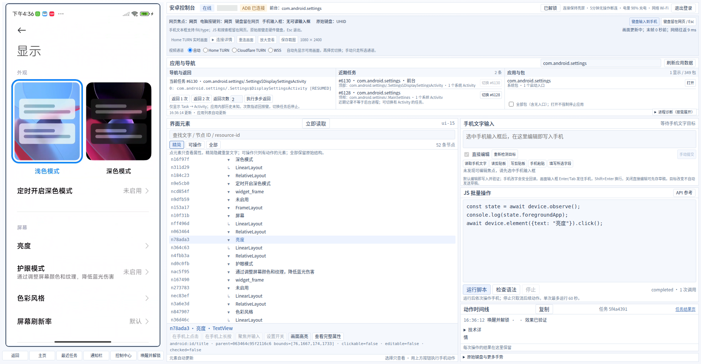

# Phone Use Page

一个面向真人用户和浏览器智能体的安卓网页控制台，无需 root。它将实时手机画面、可访问的 UI 树、文本输入和受限的 JavaScript 自动化 API 集成到同一页面。



真实安卓设备的运行画面，展示系统“显示”设置及对应 UI 树；设备元数据已遮挡。截图取自实际部署，不使用模拟设备。

## 功能

- 响应式双栏工作区：左侧尽量完整地显示手机画面，右侧提供操作和检查工具。
- 并行尝试视频通道；高优先级通道就绪后，从 WSS 升级到 Cloudflare TURN，再升级到自建 TURN，也可手动选择通道。
- 点击、拖动、长按、导航、通知栏和快捷设置操作。
- 为已确认的安卓输入目标提供真实 HTML 文本框，支持 `fill`、逐字输入、Unicode、Enter 和 Tab，并通过手机端回读验证。
- 使用 UHID 硬件键盘报告发送原始按键和快捷键；普通文本通过 UI Automator 替换输入，绕开输入法的组词过程。
- 已安装应用、最近任务、进程诊断、截图、视频重连和动作时间线。
- 受限的 QuickJS 设备 API，支持唯一目标匹配、取消任务和单次 60 秒运行限制。
- 密码登录、持久安全会话、单个在线控制页面、五分钟无操作断连，以及临时保持亮屏和恢复原设置。
- 有大小限制的请求审计日志，包含客户端 IP、浏览器标识和会话元数据；不记录密码、Cookie、输入文本或脚本正文。

界面为中文，无需 root 或解锁 Bootloader。

## 运行条件

- Node.js 22.12+、Python 3.11+、ADB，以及已授权 USB 调试的安卓设备。
- Python venv/pip；安装脚本可选使用 `uv`。
- 支持 WebCodecs/WebRTC 的较新 Chromium 浏览器；localhost 以外的浏览器访问需要 HTTPS。
- 启用 WSS 自适应编码时需要 FFmpeg。
- USB Docker Compose 配置需要 Linux。原生开发也可运行在 macOS；Docker Desktop 的 USB 和主机网络行为与 Linux 不同。

部分安卓厂商要求额外开启调试安全设置才能注入事件。硬件键盘和 UI 无障碍能力也取决于设备及应用。

某些登录页等内容受到系统录屏保护，串流可能只显示部分画面。点击机制及已记录的限制见[点击方式与受保护画面](docs/INTERACTION.md)。

## 默认部署与文档入口

复制附带环境示例后的默认方案是**本机连接已授权安卓设备、localhost 访问、仅 WSS 视频**，不默认发布公网或启用 TURN。Docker 方案另需 Linux USB 权限、自己的镜像和实际 UID/GID。未复制示例时的兼容运行时默认不同，详见[默认部署条件](docs/DEPLOYMENT_SCENARIOS.md#defaults)。

- [部署场景与配置示例](docs/DEPLOYMENT_SCENARIOS.md)：家宽 HTTPS 网关、自建 coturn、Cloudflare Tunnel/TURN、组合方案，以及逐项配置清单。
- [主机与 ADB 配置](docs/HOST_SETUP.md)：操作系统工具、设备授权、USB/用户组、容器密钥和可选无线调试。
- [完整安装部署手册](docs/SETUP.md)：从零操作步骤、升级、回滚和排障。
- [自建 TURN 的证书与运行维护](docs/TURN_MAINTENANCE.md)：容器内维护器、证书热更新、NPM/Certbot 配合、诊断日志与回滚。
- [配置参考](docs/CONFIGURATION.md)：变量含义、默认值及原生/容器路径映射。
- [兼容性与运行要求](docs/PORTABILITY.md)：设备、平台、浏览器和网络条件，以及当前限制。
- [已验证场景与排障经验](docs/VERIFIED_SCENARIOS.md)：脱敏历史记录，区分实机、外网反馈和模拟测试。

可复制/合并的文件见[示例目录](examples/deployment/README.md)。本项目不要求特定手机、NAS、路由器、DNS 或代理产品。

## 本机启动

```sh
sh scripts/setup.sh
cp .env.example .env
mkdir -p .local
chmod 700 .local
```

自行创建 `.local/console-password`，填入 12–512 个字符的密码，并设置权限为 `0600`。项目不提供默认密码。
连接多个设备时，在 `.env` 中设置 `ANDROID_SERIAL`；否则服务会自动选择单台已连接设备。用 `adb devices` 查看设备标识。

环境变量示例默认仅启用 WSS：`WEBRTC_ENABLED=0`、`VIDEO_WSS_FALLBACK=1`，不需要 TURN 密钥或外部 STUN 服务。可以按需独立启用 WebRTC 直连、自建 TURN 或 Cloudflare TURN；[视频通道配置](docs/SETUP.md#5-select-video-transports)列出了各种组合。无需 FFmpeg 自适应编码时，设置 `WSS_ADAPTIVE_ENCODER=0`。

```sh
sh scripts/start.sh
```

打开 `http://localhost:8780/`。点击“唤醒并解锁”可唤醒并解锁无需密码的设备；有密码时仍需在手机上完成解锁。

已确认的手机输入目标会显示为名为“手机输入框：……”的浏览器文本框。智能体应填写这个文本框；视频表面本身不是可填写的文本控件。文本验证后才发送 Enter/Tab；Shift+Enter 插入换行。右侧文本编辑器使用同一目标，并提供草稿模式。

## Docker 与远程访问

[DEPLOYMENT.md](DEPLOYMENT.md)提供 Linux USB 容器、反向代理、子路径、TURN 凭据、WSS 和回滚的阅读入口。
所有真实设备标识、密码、中继地址、代理地址和密钥文件都应放在本地私有配置中。

## 验证

```sh
npm run build
PYTHON_PATH=.venv/bin/python npm test
.venv/bin/python -m unittest discover -s tests -p 'test_*.py'
CHROME_PATH=/path/to/chrome npm run test:ui
npm run check:compose # 需要 Docker Compose 插件
```

浏览器测试使用模拟数据，不操作真实设备。`tests/` 下的实机测试需要主动选择运行；先配置自己的设备、地址和凭据，并审查其操作影响。测试截图及输出存放在被 Git 忽略的 `.local/` 中。

## 限制

- 自绘界面、受保护视频和部分 WebView 可能不提供可用节点或文本操作。
- 不镜像密码字段。文本替换不会同步安卓光标、选区或输入法组词状态。
- 输入法可能解释原始硬件按键；UHID 不保证按字面输入 Unicode 文本。
- 剪贴板可能为空，或受安卓权限限制；界面会明确报告不可用。
- UI 树与视频分别标记新鲜度。末帧年龄和网络往返时间不等于端到端采集延迟。
- 稳定 DOM/安卓目标可以减少引用变化，但不能保证智能体工具自身的无障碍快照引用始终有效。
- 取消脚本无法撤销已经开始执行的设备动作。

## 隐私与安全

参见[安全与开源发布边界](docs/SECURITY.md)。`.local/`、`.env`、证书、设备密钥、截图录像、审计存储和特定站点部署脚本应保持私有。
Docker 构建采用白名单上下文，Git 排除运行时和私有目录。提交或公开前运行 `npm run check:publication`。

## 许可证

应用代码采用 MIT 许可证，保留 [LICENSE](LICENSE) 法律原文，并提供[中文参考译文](docs/LICENSE.zh-CN.md)。未修改的 scrcpy 3.3.3 服务端采用 Apache-2.0，其许可证和署名保存在 [vendor/README.md](vendor/README.md) 和 `vendor/scrcpy-LICENSE` 中。依赖仍遵循各自许可证，参见[第三方声明](THIRD_PARTY_NOTICES.md)。

## 文档约定

项目介绍、README、Wiki 和安装部署等说明文档统一使用中文。包元数据、配置格式、命令、代码标识、环境变量、协议字段、软件名称和 URL 保留原始写法；许可证法律原文保留，并与中文阅读说明区分。
