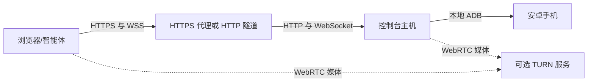

# 部署场景与配置示例

本页回答“默认能在哪运行”和“选定部署方式后要配置哪些东西”。先确定手机连接的主机，再选择网页入口，最后按需添加视频中继。操作系统准备见[主机与 ADB 配置](HOST_SETUP.md)，完整操作步骤见[安装手册](SETUP.md)，全部变量见[配置参考](CONFIGURATION.md)。

<a name="defaults"></a>

## 默认配置适合什么环境

**复制附带示例后的默认方案是本机访问、单台已授权手机、仅 WSS 视频。** 不默认创建公网网址、反向代理、隧道、TURN 服务、证书或防火墙规则。

| 启动方式 | 默认条件 | 还需配置 |
| --- | --- | --- |
| 原生：复制 `.env.example` | Linux/macOS、本地 ADB、`http://localhost:8780/`、仅 WSS、外部 STUN 关闭 | Node/Python/ADB；授权手机；自己的私有密码文件；可选 FFmpeg；多设备时选择序列号 |
| Docker：准备 `compose.env.example`，使用基础文件 + `compose.wss.yaml` | Linux Docker Engine、主机网络、USB 挂载、回环 HTTP、仅 WSS | 构建镜像标签；实际 UID/GID/USB 组；密码、状态和 ADB 密钥目录；授权手机 |
| 未复制示例，直接使用运行时/基础 Compose 默认值 | 为兼容旧部署，WebRTC 开启、WSS 关闭、使用默认 Cloudflare STUN；原生绑定回环，基础 Compose 绑定 `0.0.0.0` | 仍需密码、设备和容器权限。服务监听不等于公网 origin 已配置，也不保证媒体能跨 NAT |

默认环境文件启用 WSS 自适应编码；FFmpeg 缺失/不可用时回退到原始手机 H.264。可以显式设 `WSS_ADAPTIVE_ENCODER=0`，减少主机编码 CPU。WSS 通过 HTTPS 入口时使用 `wss://`，localhost 下实际使用 `ws://`，仍由 WebCodecs 解码。

默认保持登录 90 天；同一时间一个控制页面在线，五分钟没有显式操作则断连。视频采集上限为 1920、30 FPS、目标码率 4 Mbps；自适应 WSS 另有较低帧率/码率档位。上述参数和具体限制见配置参考，不是流量或费用硬上限。

只有一台已授权 ADB 设备时可留空 `ANDROID_SERIAL`。多设备或手机未连接时启动，应填自己的标识。不要求小米型号、SIM 卡、root 或解锁 Bootloader。

## 网页入口与视频通道分别选择



网页入口负责页面、登录、事件、控制和 WSS 视频。TURN 只中继 WebRTC；它不替代控制台，也不自动发布网页。Cloudflare Tunnel 与 Cloudflare TURN 可以独立使用，自建 TURN 也不要求页面走家宽反代。

| 需要 | 选择 |
| --- | --- |
| 先在本机试用 | 本机 localhost + 仅 WSS |
| 有可达家宽公网地址、允许开放某个 TCP 端口 | 家宽网关 HTTPS 反代，先仅 WSS |
| 无公网 IPv4、CGNAT，或不想开放入站端口 | 出站 HTTP 隧道，先仅 WSS |
| 自己管理可达的 TURN 端点 | 在任意 HTTPS 入口上增加自建 coturn |
| 不想维护 TURN 证书和端口 | 在任意 HTTPS 入口上增加 Cloudflare TURN |
| 希望尽快出画面，同时择优升级 | 已配置的 TURN 与 WSS 并行探测 |

## 示例怎么使用

[示例目录](../examples/deployment/README.md)中的 `local.env.example` 是完整原生配置。其他 `*.compose.env.example` 是**差异片段**：先完成公共准备，再合并字段到私有 `.local/compose.env`，同名字段只保留一个最终值，不要用片段覆盖整个文件。

Docker 公共准备：

1. 按主机指南安装工具并授权手机；按安装手册创建 `.local/console-password`，权限 `0600`。
2. 以运行用户执行 `sh scripts/prepare-docker.sh`，保留已有私有配置。
3. 填好实际 `CONSOLE_UID/GID`、`ANDROID_USB_GID`、私有路径及所需 `ANDROID_SERIAL`。
4. 执行 `sh scripts/build-image.sh`，把输出标签填入 `ANDROID_CONSOLE_IMAGE`。
5. 选择一个网页入口片段，再按需选择一个视频片段，使用对应 Compose 文件。

文档中的 `192.0.2.1`、`.20`、`.30` 分别代表示例网关、控制台、TURN 主机，`203.0.113.10` 代表示例公网 IPv4；均是保留地址，复制后必须换成自己的值。域名也需替换。原生运行时，用 `HOST/PORT` 替代 Compose 的 `CONSOLE_HTTP_HOST/PORT`，TURN 密钥使用 `COTURN_KEY_FILE/CF_TURN_KEY_FILE`，其余映射见配置参考。

<a name="home-proxy"></a>

## 家宽网关 HTTPS 反代

示例拓扑：浏览器访问 `https://home.example.com:9443/phone/`，网关终止 TLS，再转发到控制台 `192.0.2.20:8780`。网关和控制台可以同机，也可以分离，不要求 OpenWrt、Nginx Proxy Manager 或特定路由器。

配置项：

- DNS A 记录指向真实家宽公网 IPv4；动态地址使用自己的 DDNS 方案。HTTP/CDN 代理是否支持该外部端口，需按供应商能力确认。
- 公网 TCP 9443 转发到网关 HTTPS 监听。使用其他允许端口也可以；不要求入站 80/443。CGNAT 下普通端口转发无效，应改用隧道或公网服务。
- 网关证书匹配 `home.example.com`，并有续期方案。可用 DNS-01 验证，避免依赖入站 80。
- 控制台绑定网关可达地址，公网 origin 含外部端口、不含路径，基础/Cookie 路径均为 `/phone/`。
- `TRUST_PROXY` 填应用实际看到的代理 socket 来源。例子为 `192.0.2.1/32`，容器/NAT 可能改变这个来源；限制 8780 只允许代理访问。
- 代理保留 Host、HTTPS 协议和路径，支持三个 WebSocket 路径，并正确传递客户端 IP。不要直接开放控制台 HTTP/ADB。

参考 [home-proxy.compose.env.example](../examples/deployment/home-proxy.compose.env.example) 和 [gateway-nginx.conf.example](../examples/deployment/gateway-nginx.conf.example)。Nginx 示例放在 `http {}` 中；它展示单个互联网入口，覆盖客户端自带的 X-Forwarded-For。已有多级代理时，应按实际可信链配置，不能照搬后覆盖原始 HTTPS/客户端信息。

仅 WSS 的启动命令：

```sh
docker compose --env-file .local/compose.env -f compose.yaml -f compose.wss.yaml config --quiet
docker compose --env-file .local/compose.env -f compose.yaml -f compose.wss.yaml up -d --no-build console
```

验证公网登录、Secure Cookie、`/phone/` 资源/SDK 链接、事件/控制/WSS 连接及帧数增长。代理页面成功不代表 WebRTC 媒体已通。

<a name="home-turn"></a>

## 家宽 coturn 端点

示例拓扑：公网 `turn.example.com:8443` 转发到 TURN 主机 `192.0.2.30:5349`，UDP 52000–52063 一对一映射到该主机。控制台可以运行在另一台机器。网页入口可继续用上面的 HTTPS 反代，也可以用隧道。

需要配置：

1. 可达公网 IPv4、仅 DNS 的 TURN 主机名、匹配的可信完整证书链及私钥。普通 HTTP/CDN 代理不能直接代理 TURN TLS。
2. 网关/云安全组/主机防火墙：TCP 8443 到内部 TLS 5349，以及 UDP 52000–52063 保持端口的转发。不开放无关的管理/ADB 端口。
3. 私有 coturn 配置中的真实 `listening-ip`、`relay-ip`、`external-ip=公网IP/本地中继IP`、realm、证书和端口范围。
4. 同一 64 位十六进制共享密钥写入 coturn `static-auth-secret` 和控制台私有 JSON。运行用户需可读 `0600` 配置/证书。
5. 浏览器用公网 `COTURN_URL`；默认后端也用该 URL。没有 NAT 回流或后端需走内网时，可设 `COTURN_SERVER_URL=turns:192.0.2.30:5349?transport=tcp`，TLS 仍校验公网主机名。

完整服务配置见 [home-turnserver.conf.example](../examples/deployment/home-turnserver.conf.example)，独立容器见 [coturn Compose 示例](../examples/coturn/compose.yaml)。密钥生成、镜像用户、挂载和证书续期步骤见[安装手册自建 TURN 一节](SETUP.md#8-optional-self-hosted-coturn)。密钥和真实配置应复制到 `.local/`，不能直接使用占位符启动。

同一 LAN 中双方都走公网 relay 地址时，也可能需要 UDP NAT 回流。后端改走内网 TLS，只解决分配请求可达性，不保证两端媒体候选可达。动态公网地址变化需同时更新 DNS、coturn 外部地址和相关映射。

合并 [video-coturn.compose.env.example](../examples/deployment/video-coturn.compose.env.example)，用基础文件 + coturn，保留 WSS：

```sh
docker compose --env-file .local/compose.env -f compose.yaml -f compose.coturn.yaml config --quiet
docker compose --env-file .local/compose.env -f compose.yaml -f compose.coturn.yaml up -d --no-build console
```

此时不使用 `compose.wss.yaml`，因为它强制关闭 WebRTC。公网验证需看到 relay 候选、成功选中候选对和实际渲染帧；HTTPS GET 到 TURN 端口不证明 TURN 协议成功。

<a name="cloudflare-tunnel"></a>

## Cloudflare Tunnel 网页入口

示例拓扑：浏览器访问 `https://phone.example.com/`，Cloudflare 边缘经出站隧道到同机 `cloudflared`，再转发 `http://127.0.0.1:8780`。家宽无需入站端口或公网 IPv4。

需要配置：

- 符合 Cloudflare Tunnel 发布条件的网站/区域和主机名；不要假定自己的 DNS 已在 Cloudflare。普通自建反代无需迁移 DNS，选用此产品时才按其要求处理。
- 创建隧道和连接器，私有保存 token；或使用本地管理的 UUID/凭据 JSON。两种管理方式的凭据不能混用。
- 连接器与控制台之间的真实可达地址。例子同机使用回环；桥接网络容器不能用自己的 localhost 访问主机上的控制台。
- 精确公网 origin、根基础/Cookie 路径、实际连接器来源对应的 `TRUST_PROXY`。保留公网 Host 和原始 HTTPS。
- 按 Cloudflare 当前防火墙要求允许出站；隧道边缘通常使用 UDP/TCP 7844，相关 API/更新还需要 HTTPS。浏览器网页 443、自建 TURN 8443 和隧道出站端口是不同链路。

参考 [tunnel-wss.compose.env.example](../examples/deployment/tunnel-wss.compose.env.example)。控制台管理方式按[安装手册](SETUP.md#7-optional-cloudflare-tunnel)创建已发布应用，service 设为可达 HTTP 地址；本地管理方式参考 [cloudflared.yml.example](../examples/deployment/cloudflared.yml.example)，换成自己的 UUID、私有凭据路径，再验证 ingress。

仅 WSS 使用基础文件 + `compose.wss.yaml`。添加 TURN 时改用对应视频文件，隧道配置本身不变。Tunnel 只承担网页/控制/WSS，不能自动为 WebRTC 开 UDP 洞或承载普通 TURN。

<a name="cloudflare-turn"></a>

## Cloudflare TURN 视频中继

需要 Cloudflare Realtime TURN 账号/可用产品、专用 TURN key，以及浏览器和控制台的出站 TURN 可达性。不需要自建 TURN 端口，也不要求页面、DNS 或代理使用 Cloudflare。

在[官方控制台](https://dash.cloudflare.com/?to=/:account/calls)创建专用 key；长期 key ID/token 放在私有 `.local/cloudflare-turn-key.json`，权限 `0600`，不要把通用账号 token 或短期浏览器凭据填进去。JSON 格式、开通及账单预警步骤见[安装手册 Cloudflare TURN 一节](SETUP.md#9-optional-cloudflare-turn)。

合并 [video-cloudflare.compose.env.example](../examples/deployment/video-cloudflare.compose.env.example)，然后启动：

```sh
docker compose --env-file .local/compose.env -f compose.yaml -f compose.turn.yaml config --quiet
docker compose --env-file .local/compose.env -f compose.yaml -f compose.turn.yaml up -d --no-build console
```

该方案仅启用 Cloudflare TURN 和 WSS，不能同时保留 coturn/fallback 叠加文件。浏览器和发送端取得不同短期凭据；应用选择 `turns:turn.cloudflare.com:443?transport=tcp`。普通网页 HTTPS 能访问，不代表受限浏览器能使用该 TURN 协议。

配置自己的用量/账单预警，并核对计费覆盖范围。费用预警不保证硬性支出上限，也不代表 WSS 或隧道没有带宽成本。

## 组合方案与其他可选场景

| 场景 | 配置与状态 |
| --- | --- |
| 家宽自建 TURN 优先，Cloudflare 次优，WSS 保底 | 选任意网页入口，合并 [video-combined.compose.env.example](../examples/deployment/video-combined.compose.env.example)，使用基础 + coturn + fallback；三种通道并行，先显示可用画面，再提升优先级 |
| 两种 TURN 但不要 WSS | 同上，显式 `VIDEO_WSS_FALLBACK=0`；低优先级保障减少，需确认浏览器 TURN 可用 |
| 受限云浏览器，只能 HTTP/WebSocket | 网页入口 + 仅 WSS；检查 H.264 WebCodecs，不能假定 HTTPS 连通就支持 TURN |
| 局域网或公网 WebRTC 直连 | 合并 [video-direct.compose.env.example](../examples/deployment/video-direct.compose.env.example)，只用基础 Compose；按需 STUN/服务器 UDP 映射，Tunnel 不提供直连媒体路径 |
| 私有 SSH 访问 | 原生本机配置 + `ssh -L 8780:127.0.0.1:8780 user@console-host`，浏览器访问 localhost；不要混用另一个公网 origin |
| VPS 上部署 TURN，家中部署控制台 | 角色可以分开，公网接口 VPS 常无需家宽 NAT，但仍需证书/安全组/中继 UDP。属于架构可配置场景，不代表本文已验证你的 VPS |
| 无线 ADB、ARM、其他 NAS、其他浏览器 | 支持条件与验证等级见[兼容性与运行要求](PORTABILITY.md)，不要将参数可接受误认为已做实机测试 |

组合启动命令：

```sh
docker compose --env-file .local/compose.env -f compose.yaml -f compose.coturn.yaml -f compose.fallback.yaml config --quiet
docker compose --env-file .local/compose.env -f compose.yaml -f compose.coturn.yaml -f compose.fallback.yaml up -d --no-build console
```

## 端口与责任划分

| 链路 | 示例端口 | 由谁配置 |
| --- | --- | --- |
| 手机到控制台 | 本地 ADB TCP 5037、USB | 控制台主机，保持 ADB 私有 |
| 网关到控制台 | HTTP TCP 8780 | 内网/主机防火墙，只允许实际代理 |
| 家宽网页入口 | 公网 HTTPS TCP 9443 | DNS、网关转发、TLS 代理 |
| 自建 TURN 入口 | 公网 TCP 8443 → TLS 5349 | DNS、TURN 证书、网关/主机防火墙 |
| 自建 TURN 分配媒体 | UDP 52000–52063 | coturn、对应的一对一 NAT/防火墙 |
| WebRTC 直连 | 控制台 UDP 50000–50031 | 仅需要直连时配置可达性；不是 coturn relay 范围 |
| Cloudflare TURN | 出站 TLS/TCP 443 | 浏览器/控制台的出站网络及专用 key |
| HTTP 隧道 | 连接器出站到供应商边缘 | 按隧道产品要求，无需家宽入站转发 |

实际历史成功/失败及证据等级见[已验证场景与排障经验](VERIFIED_SCENARIOS.md)。示例可解析不等于公网已验证；部署后应检查实际视频帧、手机操作和来源审计，而不是只看 `/health`。
